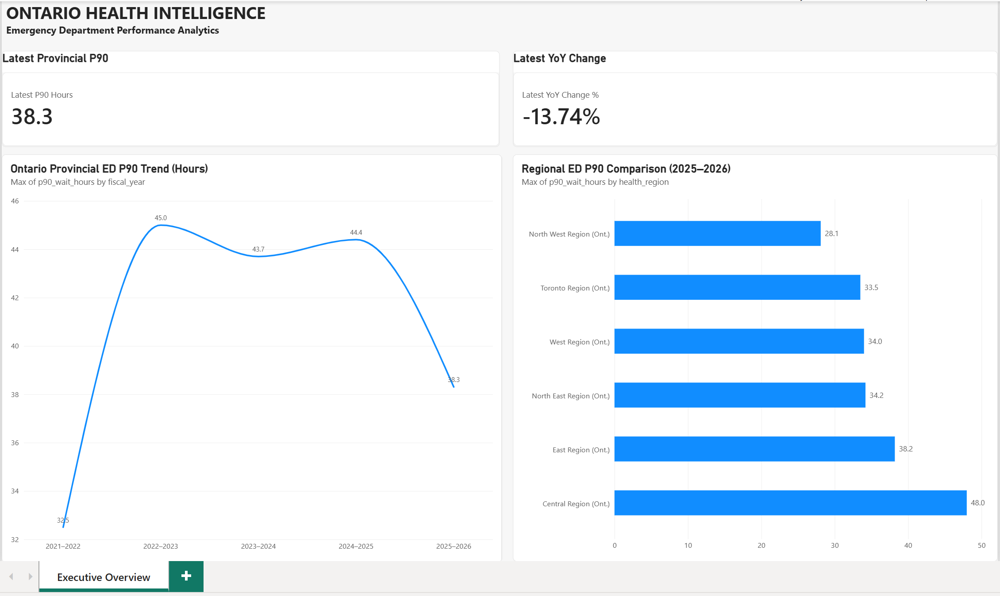
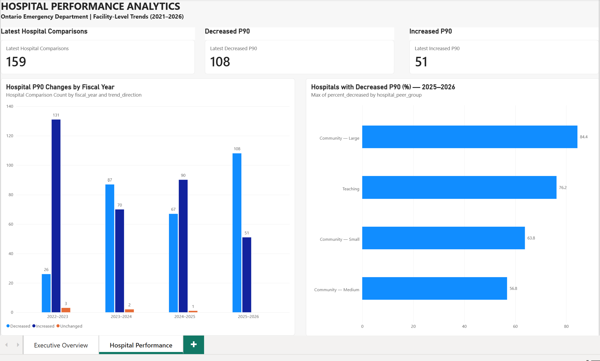
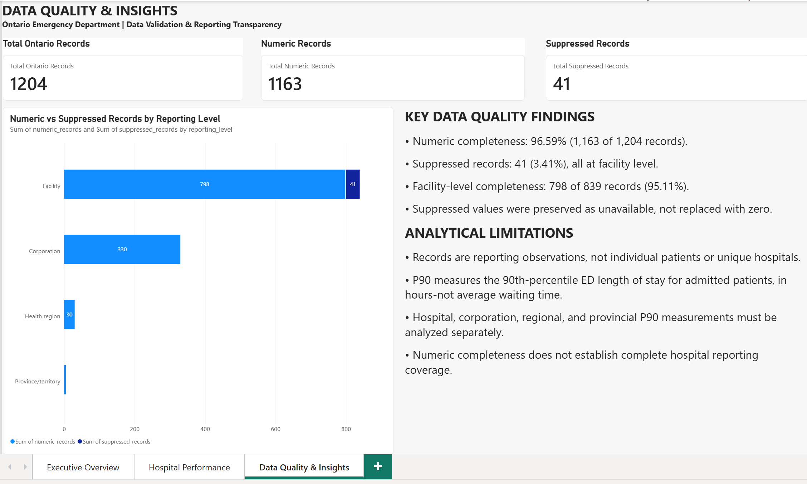
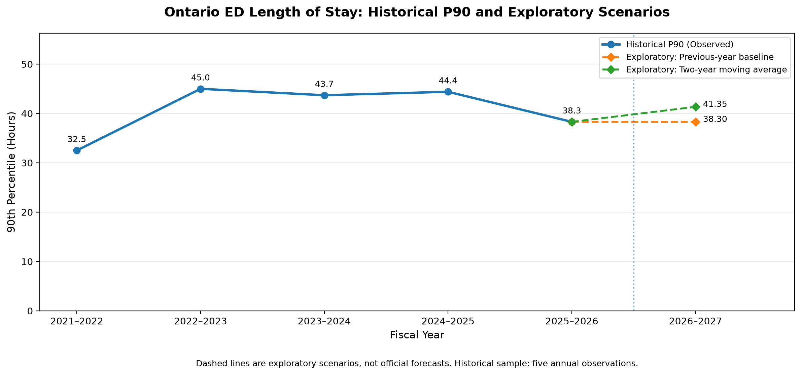

# Ontario Health Intelligence

**Emergency department length-of-stay analytics | Ontario, Canada | FY 2021–2022 to FY 2025–2026**

An end-to-end analysis of a **CIHI 90th-percentile indicator** for admitted emergency department (ED) patients. The workflow uses Python to validate the source data, SQLite and window functions to compare reporting periods, and Power BI to explore provincial, regional, and facility-level results. A small-sample forecasting exercise is included as an *exploratory scenario*, not as a reliable prediction.



## Results at a glance

| Measure | Verified result |
|---|---:|
| Ontario P90 length of stay, FY 2025–2026 | **38.3 hours** |
| Year-over-year change vs. FY 2024–2025 | **−13.74%** |
| Valid matched facility comparisons, FY 2025–2026 | **159** |
| Facility comparisons with decreased P90 | **108 (67.92%)** |
| Numeric observations / total Ontario reporting records | **1,163 / 1,204 (96.59%)** |
| Suppressed observations | **41** |

**Interpretation:** The P90 is the length-of-stay threshold at or below which 90% of admitted ED patients fall. It is **not** the mean patient waiting time or time to first physician assessment. A lower observed P90 does not, on its own, establish why performance changed.

## Interactive dashboard

The Power BI file, [`powerbi/Ontario_Health_Intelligence.pbix`](powerbi/Ontario_Health_Intelligence.pbix), contains three pages.

| Page | What it shows |
|---|---|
| Executive Overview | Provincial history, latest P90 and YoY change, six regional results |
| Hospital Performance | Matched facility changes, direction counts and hospital peer-group comparisons |
| Data Quality & Insights | Suppressed results, numeric completeness and analytical limitations |

### Hospital performance



### Data quality and limitations



## SQL and methodology

- **5 SQL analyses:** provincial YoY trends, facility/peer-group availability, matched hospital YoY comparisons, peer-group summaries and health-region trends.
- **Matched facilities:** fiscal years must be consecutive; duplicate facility-year identifiers and suppressed P90 readings are excluded from comparisons.
- **Data quality:** 41 suppressed values are preserved as missing; numeric completeness is a share of *reporting observations*, not proof of complete Ontario hospital coverage.
- **Reporting levels:** facility, corporation, health region and province values are not summed or averaged together as patient-level P90 measures.
- **Statistics:** the mean and standard deviation describe the **five annual P90 values**, not individual ED visits.

### Exploratory next-year scenarios



Two simple one-step-ahead baselines were backtested on the **same three years**. The previous-year baseline achieved **2.70 h MAE**; the two-year moving-average baseline achieved **3.58 h MAE**. Their FY 2026–2027 illustrative values are **38.30 h** and **41.35 h** respectively. Five annual observations are not enough for dependable forecasting or confidence intervals.

For detailed findings see [`reports/final_insights.md`](reports/final_insights.md) and [`reports/forecast_methodology.txt`](reports/forecast_methodology.txt).

## Reproduce locally (VS Code)

1. Open this folder in VS Code and select a Python interpreter that has the libraries in [`requirements.txt`](requirements.txt) installed.
2. Open **`run_pipeline.py`** and click **Run Python File**. No manually typed terminal commands are required. The script uses the included source workbook; if missing, it downloads a copy from CIHI.
3. The pipeline creates an SQLite database and cleaned datasets under `data/processed/`, refreshes the five SQL result exports, and generates the analysis outputs under `reports/`.
4. Open the `.pbix` report in Power BI Desktop. Its data was imported from local CSVs; to refresh on another computer, go to **Transform data → Data source settings** and update the CSV source locations to your local `data/processed/` folder.

The reviewed source workbook is included so these results can be reproduced with the same data snapshot. A future CIHI download may contain updated results, in which case the original fixed-count checks may need to be revised.

## Repository layout

```text
OntarioHealthIntelligence/
├── README.md
├── run_pipeline.py
├── requirements.txt
├── python/             # ingestion, cleaning, validation, SQL runner, statistics
├── sql/                # five analytical SQLite queries
├── data/
│   ├── raw/            # CIHI source workbook
│   └── processed/      # curated dashboard/analysis CSV exports
├── powerbi/            # three-page .pbix report
├── assets/             # report screenshots and clean forecast figure
└── reports/            # key written findings and forecast methodology
```

## Data source and attribution

**Source:** Canadian Institute for Health Information (CIHI), [*Total Time Spent in Emergency Department for Admitted Patients*](https://www.cihi.ca/en/indicators/total-time-spent-in-emergency-department-for-admitted-patients). Indicator results updated **September 2026**; workbook used here covers fiscal years **2021–2022 through 2025–2026**.

The original data, indicator definitions, and reporting limitations belong to CIHI. This is an **independent, non-commercial educational portfolio project** and is not affiliated with or endorsed by CIHI. Read [CIHI's terms of use](https://www.cihi.ca/en/about-cihi/terms-of-use) before reusing the material, particularly in commercial products. CIHI requires source credit and restricts certain commercial and software uses.

## Limitations

- This is aggregated **public reporting data**, not identifiable patient-level data.
- Suppression, hospital naming changes, case mix, reporting completeness and regional context may affect comparisons.
- There are only five province-level annual observations; the forecasting illustration is not suitable for clinical or operational decision-making.
- No causal inference, formal hospital quality ranking, or statistically significant trend is claimed.
